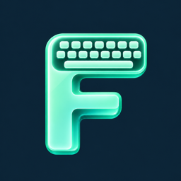
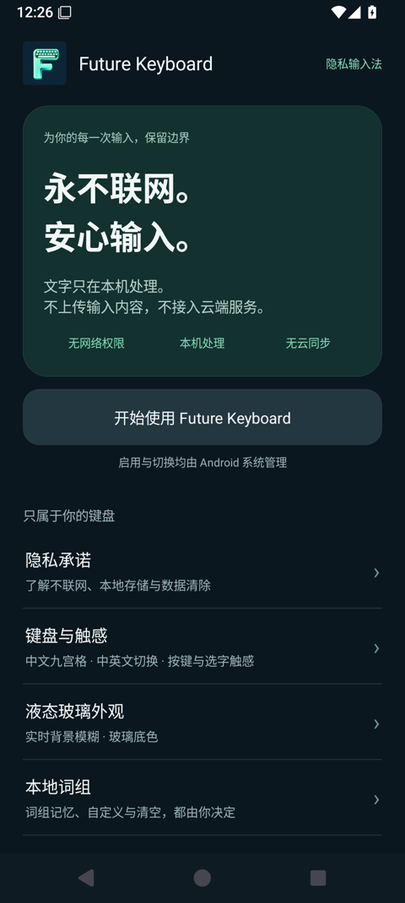
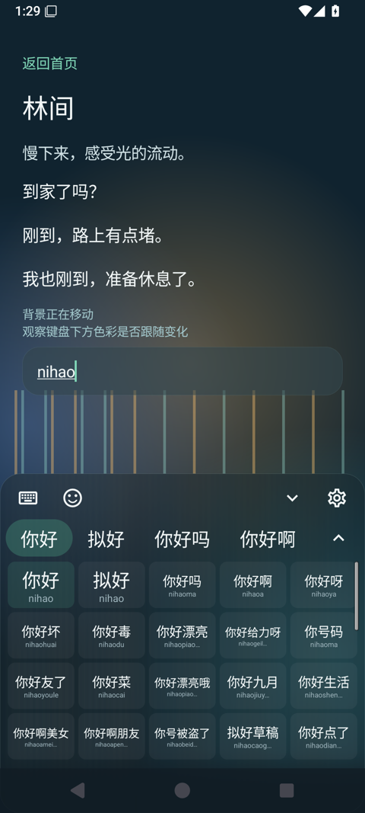
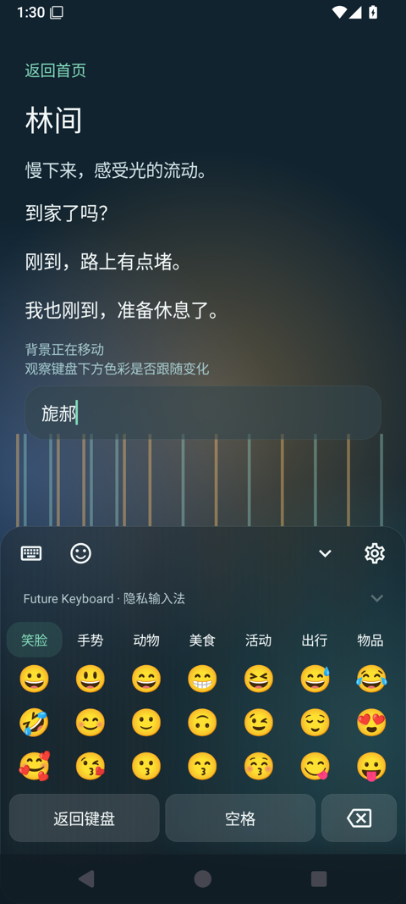

<p align="center">
  
</p>
<h1 align="center">Future Keyboard</h1>
<p align="center"><strong>永不联网，安心输入。</strong></p>
<p align="center">液态玻璃外观 · 中文九宫格 / 全键盘 · 中英文离线词语联想 · 本地组词记忆</p>
<p align="center">
  <a href="https://github.com/davidren0513/Future-Keyboard/releases/tag/v0.6.0">下载 APK</a> ·
  <a href="docs/PRIVACY.md">隐私说明</a> ·
  <a href="docs/BUILDING.md">构建与验证</a> ·
  <a href="CHANGELOG.md">更新记录</a>
</p>

Future Keyboard 是由 **David Ren** 开发的原生 Android 隐私输入法。它把词库查询、候选计算和个人词组记忆放在设备上完成，应用不申请网络权限，不上传输入内容，也没有账号和云同步。

当前为 **0.6.0 测试版**，支持 **Android 8.0 及以上**。实时背景模糊需要 Android 12+ 且设备与系统允许跨窗口模糊；不可用时采用深色玻璃底板。尚未覆盖全部品牌真机，请结合下方验证范围试用。

## 实际界面

| 隐私与设置首页 | 多行候选 | 分类 Emoji |
| :---: | :---: | :---: |
|  |  |  |

截图来自 Android 15 / API 35 模拟器。候选与 Emoji 为 0.6.0；设置首页沿用 0.4.0 的实际界面。[截图来源与验证范围](docs/VALIDATION.md)

## 为什么做它

一句准备发送的话，在按下发送之前，已经先经过了键盘。我们希望用户能清楚知道，输入法怎样处理这些文字。

Future Keyboard 始终离线运行。应用不包含云输入、广告或分析 SDK；连应用内关于页的官网和开源项目地址，也只展示为文字，许可说明可以离线阅读。GitHub 文档中的链接仅供在浏览器阅读项目时使用。

文字确认后会交给当前使用的聊天软件或其他应用。那些应用怎样处理数据，仍遵循各自规则；本项目的隐私承诺适用于输入法自身。[详细隐私说明](docs/PRIVACY.md)

## 已有功能

| 功能 | 当前行为 |
| --- | --- |
| 中文输入 | 完整拼音、中文九宫格及全键盘，890,251 条带词频的内置字词记录 |
| 逐字组词 | 词组候选后继续提供首音节单字，选择后保留剩余拼音；开启本地学习时记住完整组合 |
| 完整单字表 | 8,757 条字音记录，含多音字；不受普通候选 24 项上限截断 |
| 多行候选 | 候选栏最右侧箭头展开 / 收起，在键盘区域以五列网格上下滚动 |
| 英文输入 | 21,207 个本地单词用于补全，附基础常用搭配；空格保留原词，点击候选采用补全 |
| Emoji | 8 个分类、867 个条目，支持滚动浏览；字形由本机系统提供 |
| 快捷工具栏 | 布局选择、Emoji、收起键盘、设置入口 |
| 本地学习 | 自定义词组、词频排序、关闭学习与清空；密码及禁止个性化学习的输入场景不学习 |
| 液态玻璃 | 在受支持系统上模糊真实宿主背景，可调整强度与底色；按键与选字触感可关闭 |

这里的联想是词语补全和常用搭配推荐，**不做整句预测或生成**。英文搭配表仍较基础，中文与英文的覆盖都受随包词表限制。九宫格存在同码拼音，单字候选标注实际读音，明确分词可使用分词键。

## 下载与启用

1. 从 [Releases](https://github.com/davidren0513/Future-Keyboard/releases) 下载测试版 APK，在 Android 上安装。
2. 打开 Future Keyboard，进入「启用与切换」，按系统提示启用并选择输入法。
3. 在「键盘与触感」选择九宫格或全键盘；键盘工具栏也可以随时切换布局。
4. 按需开启本地学习。没有找到词组时，继续浏览单字候选，逐字选完即可；候选较多时点右侧箭头展开。

包名为 `com.liquidglass.ime`。系统对第三方输入法显示的通用提示并不表示本应用会联网；最终 APK 的网络权限可由随仓库提供的脚本检查。

目前发布的是 **debug 测试签名 APK**，不代表正式商店发行版。不同机器或 CI 生成的 debug 签名可能不同，升级时请先核对签名；不要为解决冲突而直接卸载唯一保有本地词组的版本。正式发布签名尚未配置，仓库不包含签名私钥。

## 开发与验证

原生 Java 17，Gradle 8.11.1，Android Gradle Plugin 8.9.1，compileSdk / targetSdk 35，minSdk 26。工程不依赖云服务。

```sh
git clone https://github.com/davidren0513/Future-Keyboard.git
cd Future-Keyboard
# 安装 JDK 17、Android SDK Platform 35 / Build Tools 35.0.0，并配置 ANDROID_HOME
./gradlew :app:assembleDebug :app:testDebugUnitTest :app:lintDebug
python3 scripts/verify_offline.py
```

构建机器首次获取 Gradle、Android 工具链及测试依赖需要网络；这些构建操作与应用运行时行为不同。已缓存依赖可加 `--offline`。随包词库已纳入源码，正常构建无需重新下载词库。

[完整构建说明、词库来源与重建、模拟器检查](docs/BUILDING.md)

0.6.0 本地已通过 **18 项单元测试、19 项模拟器交互检查、Android Lint 与 APK 离线权限审计**。真机适配、全部系统版本、横屏及大字体组合尚未全面验证。[验证边界](docs/VALIDATION.md)

## 作者与许可

- 作者 **David Ren**
- 公司 **南通未界科技有限公司**
- 官网 **nt-future.tech**

项目以 [GNU GPL v3](LICENSE) 发布。感谢 [雾凇拼音 / Rime Ice](https://github.com/iDvel/rime-ice) 的 iDvel 与贡献者、Google Material Design Icons、AOSP、Gradle，以及词库更早的来源作者。GPL 字典数据、MIT 资料及 Apache 许可分别保留归属与许可文本，详见 [第三方鸣谢](THIRD_PARTY_NOTICES.md)。

欢迎通过 [Issues](https://github.com/davidren0513/Future-Keyboard/issues) 反馈问题。请使用不涉及隐私的测试文字，**不要上传真实聊天记录、个人词库或密码**。
